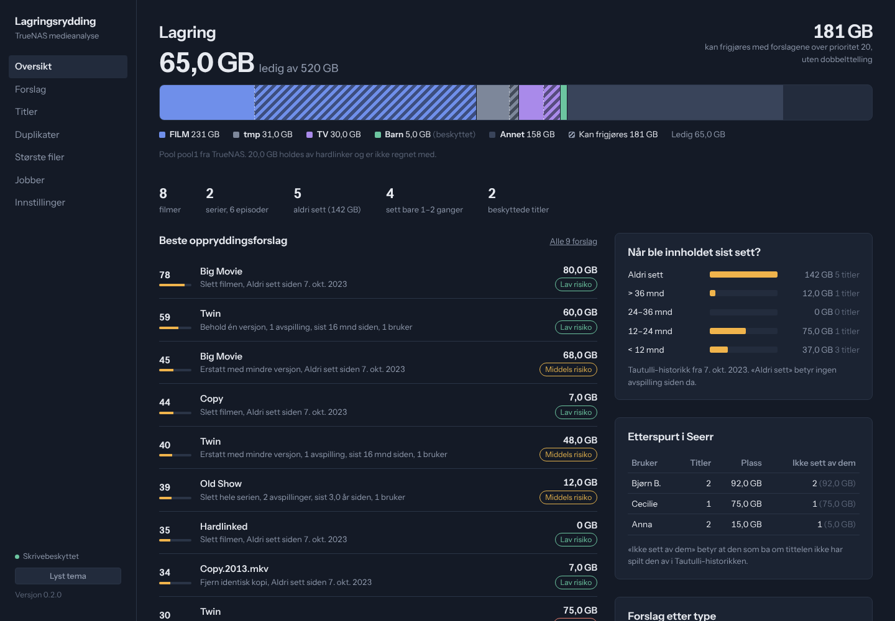
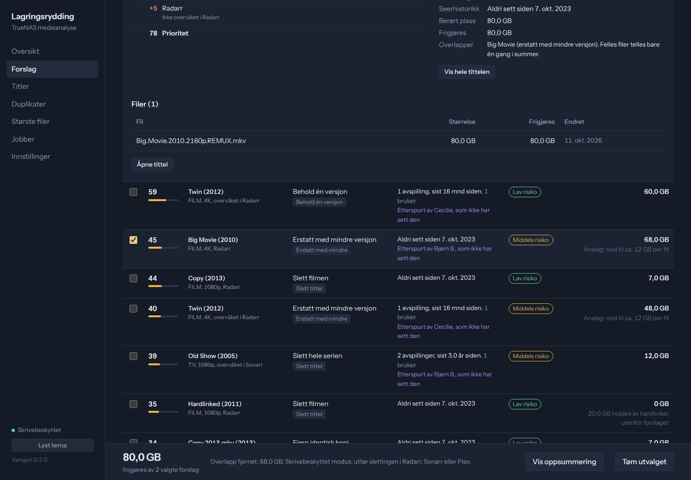
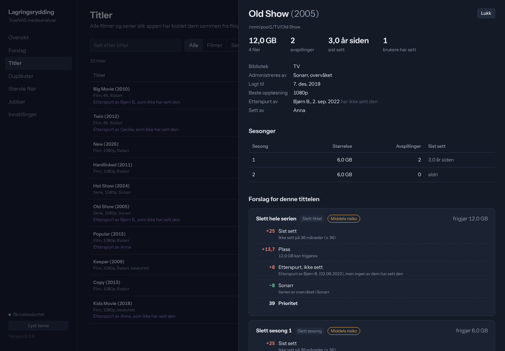
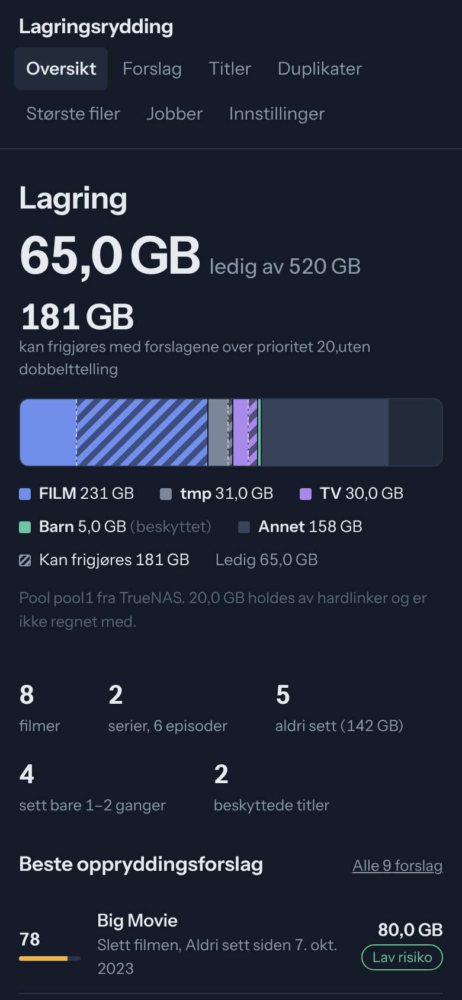

# Smart Media Cleanup

Skrivebeskyttet analyse av mediebiblioteket på TrueNAS SCALE. Appen kobler filene på disk til Radarr, Sonarr, Plex og Tautulli og gir rangerte, forklarte forslag til hva som kan slettes, erstattes eller ryddes – med plassbesparelse beregnet uten dobbelttelling.

**Appen har bare lesetilgang til mediemappene** (`:ro`). Sletting er av som standard. Slås den på, slettes filmer og serier via Radarr og Sonarr – aldri direkte i filsystemet.



<sub>Skjermbildene viser testdata fra den automatiske testen, ikke et ekte bibliotek.</sub>

---

## Innhold

1. [Hva appen gjør](#hva-appen-gjør)
2. [Sikkerhetsmodell](#sikkerhetsmodell)
3. [Installasjon på TrueNAS SCALE 25.10](#installasjon-på-truenas-scale-2510)
4. [Første oppsett](#første-oppsett)
5. [Bruk](#bruk)
6. [Slik regnes prioriteten](#slik-regnes-prioriteten)
7. [Konfigurasjon](#konfigurasjon)
8. [Oppdatering](#oppdatering)
9. [Backup og gjenoppretting](#backup-og-gjenoppretting)
10. [Feilsøking](#feilsøking)
11. [Arkitektur og utvikling](#arkitektur-og-utvikling)
12. [Kjente begrensninger](#kjente-begrensninger)

---

## Hva appen gjør

- **Oversikt:** kapasitet, bruk per bibliotek, antall filmer/serier/episoder, hvor mye som aldri er sett eller ikke sett på 12/24/36 måneder, største titler og filer, og hvor mye forslagene samlet kan frigjøre.
- **Forslag:** rangert liste med søk, filtre og sortering. Hver rad viser handling, risiko, seerhistorikk og frigjort plass. Åpnet rad viser poengberegningen linje for linje, konsekvenser for Radarr/Sonarr/Plex og berørte filer.
- **Utvalg:** huk av forslag og se samlet gevinst. Overlapp (for eksempel en serie og en av sesongene) og hardlinker telles riktig.
- **Duplikater:** tre kategorier holdes adskilt – identiske kopier, alternative versjoner og hardlenker (som ikke er duplikater).
- **Titler og største filer:** oppslag og sortering for 4K-remuxer, ISO-filer og store episoder.
- **Filmer og Serier:** egne sider med oppsummering øverst – hva som aldri er sett, ikke sett på lenge, trygge slettinger – og en liste som kan filtreres og sorteres på størrelse, seing, anbefaling og gevinst.
- **Brukere (Seerr):** hvem som ba om hva, og om de har sett det selv. Egen side per bruker med oppsummering og filter for det de ikke har sett.
- **Sletting (valgfritt):** filmer, serier og enkeltsesonger slettes via Radarr/Sonarr etter en oppsummering. Av som standard.

Forslagstyper:

| Type | Når | Frigjør |
|---|---|---|
| Slett tittel | Film/serie over minstestørrelsen | Alle filer i mappen |
| Slett sesong | Serie som sees, men en sesong har ikke vært sett på lenge | Sesongens filer |
| Erstatt med mindre | Film over 40 GB eller episode over 8 GB (justerbart) | Anslag: størrelse minus målstørrelse |
| Behold én versjon | Flere ulike filer for samme film/episode | De andre versjonene |
| Identisk kopi | Samme størrelse + delvis hash, ulik inode | Kopien(e) som ikke beholdes |
| Gammel nedlasting | Mappe i `tmp` uten kopi i biblioteket, eldre enn en måned | Mappen |

### Skjermbilder

| Forslag med forklaring og utvalg | Tittel med sesonger og forespørsler |
|---|---|
|  |  |



## Sikkerhetsmodell

| Tiltak | Hvordan |
|---|---|
| Ingen skrivetilgang til media | Alle mediemapper monteres `:ro` i YAML |
| Sletting bare via Radarr/Sonarr | Av som standard. Når den er på, kaller appen Radarrs og Sonarrs egne slette-API-er; selve filene slettes av dem |
| Minst mulig privilegier | Kjører som `568:568` (apps), `cap_drop: ALL`, `no-new-privileges`, skrivebeskyttet rotfilsystem |
| Bare nødvendige mapper | Kun FILM, TV, Barn og tmp monteres. `app-config`, `ix-applications`, `frigate-recordings` m.fl. er utenfor rekkevidde |
| Ingen ZFS-tilgang | Ingen `zfs`-kommandoer. Valgfri TrueNAS-integrasjon bruker en API-nøkkel med rollen *Read-Only Admin* |
| Hemmeligheter | Lagres i `/data/settings.json` (rettigheter 600) eller som miljøvariabler. Maskeres i API og UI |
| Beskyttelse | Barn-biblioteket, tagger (`keep`, `behold`) i Radarr/Sonarr og etiketter i Plex gir aldri forslag |
| Logg | Endringer i innstillinger loggføres i databasen (`audit`) |

### Sletting

Slås på under **Innstillinger → Sletting**. Slett fra tittelvisningen (knappen «Slett filmen / serien / sesong N»), eller kryss av titler i Forslag, Filmer, Serier eller på en brukerside og trykk **Slett valgte…**. Du kan slette:

| Hva | Hvordan |
|---|---|
| Hel film | Slettes i Radarr med filer (`deleteFiles`). Legges ikke på ekskluderingslisten. |
| Hel serie | Slettes i Sonarr med filer. |
| Én sesong | Sesongen avovervåkes i Sonarr, deretter slettes episodefilene. |

**Duplikatfiler** (identiske kopier og ekstra versjoner) administreres normalt ikke av Radarr/Sonarr, og slettes derfor direkte fra disk under **Duplikater**. Det er av som standard og krever to ting: bryteren «Tillat sletting av overflødige duplikatfiler» under Innstillinger → Sletting, og at mappene er montert uten `:ro` i appens YAML. I hver gruppe velger du hvilken fil som beholdes. Filer Radarr/Sonarr kjenner slettes aldri på denne måten, filen som beholdes blir alltid liggende, og beskyttede biblioteker/titler (som Barn) kan ryddes for duplikater med mindre «Beskyttelse gjelder også duplikater» er slått på, og hver fil sjekkes rett før sletting (uendret siden skanning, inne i et bibliotek, ikke en symlenke). Titler utenfor Radarr/Sonarr og nedlastinger i qBittorrent gjøres fortsatt manuelt.

Sikringer, uavhengig av hva som velges i grensesnittet:
- Beskyttede titler (Barn, tagger, Plex-etiketter, beskyttede stier) avvises av serveren.
- Først vises en oppsummering av hva som slettes og hvor mye som frigjøres. Bare akkurat det som ble vist utføres – er analysen endret i mellomtiden, avvises slettingen og oppsummeringen må åpnes på nytt.
- Rett før hver sletting hentes tittelen på nytt fra Radarr/Sonarr. Stemmer ikke mappen med analysen, stoppes den slettingen.
- Alt loggføres under **Logg**. Etterpå startes en full oppdatering automatisk.

## Installasjon på TrueNAS SCALE 25.10

TrueNAS 25.10 kjører apper i Docker, og egne apper legges inn med **Apps → Discover Apps → pilen ved «Custom App» → Install via YAML** (Docker Compose med `services:`-nøkkel). Fremgangsmåten under er laget for den mekanismen.

### 1. Lag datasett og mapper

I **Datasets**: lag `pool1/apps` og deretter `pool1/apps/mediacleanup` (preset *Apps* er fint). Så i TrueNAS-shell:

```sh
mkdir -p /mnt/pool1/apps/mediacleanup/data
chown -R 568:568 /mnt/pool1/apps/mediacleanup/data
```

### 2. Image fra GitHub

Kildekoden ligger på [github.com/pederko/smart-media-cleanup](https://github.com/pederko/smart-media-cleanup). Ved hver push til `main` kjører GitHub Actions testene og publiserer et ferdig image til GitHub Container Registry:

| Tagg | Innhold |
|---|---|
| `latest` | Siste utgivelse (brukes i YAML-filen) |
| `0.3.0`, `0.3` | En bestemt utgivelse, hvis du vil låse versjonen |
| `edge` | Siste commit på `main` (kan være uferdig) |

Er repoet offentlig, kan TrueNAS hente imaget uten innlogging. Er det privat, må du enten gjøre *pakken* offentlig (GitHub → Packages → smart-media-cleanup → Package settings → Change visibility) eller legge inn GHCR-innlogging i TrueNAS med en token som har `read:packages`.

### 3. Bygge selv (valgfritt)

Trenger du ikke GitHub, kan du bygge på TrueNAS og bruke `image: smart-media-cleanup:0.2.0` med `pull_policy: never` i YAML:

```sh
git clone https://github.com/pederko/smart-media-cleanup.git /mnt/pool1/apps/mediacleanup/src
docker build -t smart-media-cleanup:0.2.0 /mnt/pool1/apps/mediacleanup/src
```

### 4. Installer appen

Bruk **Install via YAML**, ikke skjemaet «Install iX App» (det med felter for Repository, Tag, Hostname osv.):

1. Apps → **Discover Apps**.
2. Øverst til høyre: klikk pilen/menyen ved siden av **Custom App** og velg **Install via YAML**.
3. **Name:** `mediacleanup`.
4. **Custom Config:** lim inn hele [`deploy/truenas-app.yaml`](deploy/truenas-app.yaml).
5. **Save.** TrueNAS henter imaget og starter appen på **http://<truenas-ip>:30480**.

<details><summary>Foretrekker du skjemaet «Install iX App»? Slik fylles det ut</summary>

| Seksjon | Felt | Verdi |
|---|---|---|
| Application name | Name | `mediacleanup` |
| Image Configuration | Repository | `ghcr.io/pederko/smart-media-cleanup` |
| | Tag | `latest` |
| Container Configuration | Timezone | `Europe/Oslo` |
| Security Context | Privileged | av |
| | Custom User | på, User ID `568`, Group ID `568` |
| Network Configuration | Ports | Container port `8000`, Host port `30480`, TCP |
| Storage Configuration | Host Path | `/mnt/pool1/apps/mediacleanup/data` → `/data` |
| | Host Path, Read Only | `/mnt/pool1/FILM` → `/media/FILM` |
| | Host Path, Read Only | `/mnt/pool1/TV` → `/media/TV` |
| | Host Path, Read Only | `/mnt/pool1/Barn` → `/media/Barn` |
| | Host Path, Read Only | `/mnt/pool1/tmp` → `/media/tmp` |
| Resources | Limits | 1 CPU, 1024 MB (valgfritt) |

Resten kan stå som standard. YAML-veien gir i tillegg skrivebeskyttet rotfilsystem og fjernede Linux-capabilities.
</details>

### 5. Ikon i TrueNAS (valgfritt)

TrueNAS har ikke noe felt for ikon på egne YAML-apper, så appen vises med standardikonet. Ikonet kan settes i appens metadatafil med et lite skript (lager sikkerhetskopi først):

```sh
curl -fsSLo /tmp/set-icon.sh https://raw.githubusercontent.com/pederko/smart-media-cleanup/main/deploy/set-truenas-icon.sh
sh /tmp/set-icon.sh mediacleanup
```

Last Apps-siden på nytt. Ikonet kan bli tilbakestilt når appen redigeres (Edit) – kjør i så fall skriptet igjen. Det påvirker bare visningen i TrueNAS.

**Om versjonsnummeret i TrueNAS:** «App Version: custom» og «Version: 1.0.0» under Application Info gjelder TrueNAS sin innpakning av egne apper, ikke Smart Media Cleanup. Appens egen versjon står nederst i menyen i appen og i informasjonen om imaget i TrueNAS.

### 6. Legg til i Homarr (valgfritt)

Lag en app-tile i Homarr med adressen `http://<truenas-ip>:30480`. Ingen integrasjon utover lenken trengs.

## Første oppsett

Ved første oppstart kjører appen en full oppdatering automatisk. Uten tjenester konfigurert får du filstørrelser og grove forslag. Med tjenestene får du seerhistorikk, overvåkingsstatus og riktige konsekvenser.

Åpne **Innstillinger** og fyll inn:

| Tjeneste | Adresse (fra containeren) | Nøkkel |
|---|---|---|
| Radarr | `http://<truenas-ip>:30025` | Settings → General → API Key |
| Sonarr | `http://<truenas-ip>:30027` | Settings → General → API Key |
| Plex | `http://<truenas-ip>:32400` | X-Plex-Token: åpne et element → ⋯ → Get Info → View XML, token står i adressen |
| Tautulli | `http://<truenas-ip>:30047` | Settings → Web Interface → API key |
| Seerr (valgfritt) | `http://<truenas-ip>:30357` | Settings → General → API Key |
| TrueNAS (valgfritt) | `https://<truenas-ip>` | API-nøkkel for en bruker med rollen *Read-Only Admin* |

Bruk TrueNAS-maskinens LAN-IP. `localhost` peker på containeren selv, og appene ligger i hvert sitt Docker-nettverk.

Trykk **Test tilkobling** for hver, **Lagre innstillinger**, og kjør **Full oppdatering** under Jobber.

**Stimapping:** Radarr, Sonarr, Plex og qBittorrent ser mappene som `/FILM`, `/TV`, `/Barn` og `/tmp-download`/`/downloads`. Dette er forhåndsutfylt og oversettes til `/mnt/pool1/...`. Endrer du mounts i de appene, oppdater mappingen.

**Om TrueNAS-integrasjonen:** Lag en egen bruker (Credentials → Users) med rollen *Read-Only Admin*, og lag en API-nøkkel for den brukeren. Appen leser da pool-kapasitet, datasett og om rotdatasettet har snapshots (slettet plass frigjøres ikke før snapshotene utløper). Uten integrasjonen måles kapasitet med `statvfs` på det monterte datasettet, som for `pool1` gir praktisk talt samme tall.

## Bruk

- **Oversikt** gir hele bildet. Skravert område i kapasitetsstolpen er det forslagene over prioritetsterskelen kan frigjøre.
- **Forslag**: start med filteret *Lav risiko*, sortert etter prioritet. Åpne en rad for å se begrunnelsen. Huk av det du vil gjøre, og bruk **Vis oppsummering** som arbeidsliste. **Eksporter CSV** gir samme liste til regneark.
- **Gjennomfør i riktig verktøy**:
  - Film i Radarr: *Delete* → kryss av *Delete files* og *Add exclusion*.
  - Hel serie i Sonarr: *Delete* → *Delete files*.
  - Én sesong: avovervåk sesongen i Sonarr først, slett så filene.
  - Erstatt med mindre: endre kvalitetsprofil i Radarr/Sonarr og søk på nytt.
  - Identiske kopier i `tmp`: fjern torrenten i qBittorrent (med filer) hvis den fortsatt seeder.
- Etter slettingen: kjør **Skann endringer** eller vent på neste automatiske skanning.

### Forespørsler fra Seerr

Når Seerr er koblet til, vises «Etterspurt av …» på forslag og titler. Forespørsler kobles via TMDB-/TVDB-id i Radarr/Sonarr, og via Plex ratingKey for titler som ikke ligger der. Om den som ba om tittelen har sett den, avgjøres ved å sammenligne Seerr-brukerens visningsnavn og Plex-brukernavn med Tautulli-historikken. Klikk et navn i «Etterspurt i Seerr» på oversikten for å se forslagene for den brukeren.

### Seerhistorikk

Historikken kommer fra Tautulli og går bare tilbake til da Tautulli ble installert. «Aldri sett» betyr derfor *ingen avspilling siden historikken startet* – datoen vises på oversikten. Avspillinger under 5 % telles ikke. Når en tittel er byttet ut i Plex og har fått ny `ratingKey`, matches avspillingene på navn og år.

## Slik regnes prioriteten

Prioriteten (0–100) er en sum av synlige delpoeng. Ingen skjult modell. Hvert forslag viser hvilke linjer som gjelder.

| Faktor | Poeng |
|---|---|
| Plass som faktisk frigjøres | 0 til +35 (logaritmisk: 10 GB ≈ 12, 30 GB ≈ 24, 70 GB+ = 35) |
| Aldri sett siden historikken startet | +30 (+22 hvis lagt til etter at historikken startet) |
| Ikke sett på ≥ 36 / ≥ 24 / ≥ 12 mnd | +25 / +18 / +10 |
| Sett siste 3 mnd | −20 |
| Høyst 2 avspillinger og ≥ 20 GB | +8 |
| 10 eller flere avspillinger | −10 |
| Seere siste 12 mnd | −6 per bruker (maks −30) |
| Overvåket i Radarr/Sonarr | −8 (ikke overvåket: +5) |
| Lagt til innen karantenetiden (6 mnd) | −40 |
| Etterspurt i Seerr siste 12 mnd | −15 |
| Etterspurt for over 12 mnd siden, og ingen som ba om den har sett den | +8 |
| Innholdet beholdes i annen versjon | +25 (versjoner/kopier), +10 (erstatning) |

Alle terskler og vekter kan endres under Innstillinger. Forslag under prioritet 20 skjules som standard.

**Risiko:** *Høy* hvis sett siste 12 mnd, sett av minst to brukere nylig, nylig lagt til eller nylig etterspurt. *Middels* hvis overvåket eller sett noen gang. Ellers *lav*. Identiske kopier er alltid lav risiko.

**Gevinst uten dobbelttelling:** hver fil (inode) telles én gang, med det høyeste kravet fra forslagene som er valgt. En hardlenket fil frigjør bare plass når alle stiene til den er med i utvalget. Ellers vises beløpet som «holdes av hardlinker». Størrelser er allokert plass på ZFS (`st_blocks`), ikke bare logisk filstørrelse.

## Konfigurasjon

Innstillinger lagres i `/data/settings.json` og redigeres i appen. Miljøvariabler overstyrer og låser feltene:

| Variabel | Betydning |
|---|---|
| `SMC_RADARR_URL`, `SMC_RADARR_API_KEY` | Radarr |
| `SMC_SONARR_URL`, `SMC_SONARR_API_KEY` | Sonarr |
| `SMC_PLEX_URL`, `SMC_PLEX_TOKEN` | Plex |
| `SMC_TAUTULLI_URL`, `SMC_TAUTULLI_API_KEY` | Tautulli |
| `SMC_SEERR_URL`, `SMC_SEERR_API_KEY` | Seerr/Overseerr |
| `SMC_TRUENAS_URL`, `SMC_TRUENAS_API_KEY` | TrueNAS (read-only) |
| `SMC_USERNAME`, `SMC_PASSWORD` | Slår på innlogging (Basic auth) for nettsiden |
| `SMC_LOG_LEVEL` | `INFO` (standard) eller `DEBUG` |
| `TZ` | Tidssone, standard `Europe/Oslo` |

**Port:** endre `30480` i `ports:` i YAML.
**Biblioteker:** legg til et volum `:ro` i YAML og en rad under Innstillinger → Biblioteker med samme containersti.

### Planlagte jobber

| Jobb | Standard |
|---|---|
| Synk med tjenestene | hver 6. time |
| Inkrementell skanning | hver 24. time |
| Full skanning (stat av alle filer) | hver 7. dag, som del av en oppdatering |
| Backup av database og innstillinger | daglig, 7 beholdes |

Bare én jobb kjører om gangen. Inkrementell skanning leser bare filinformasjon i mapper der innholdet er endret (mappens mtime), og typisk tar den sekunder. Delvis hash (12 MB per fil) beregnes kun for filer som har nøyaktig samme størrelse som en annen fil.

## Oppdatering

YAML-filen bruker `ghcr.io/pederko/smart-media-cleanup:latest`. Når en ny versjon publiseres:

1. Appen viser et banner («Versjon X er tilgjengelig») med lenke til hva som er nytt. Den sjekker GitHub hver 6. time; kan slås av under Innstillinger → Oppdateringer.
2. TrueNAS følger med på imaget og viser **Update available** på appen.
3. Oppdater med Apps → mediacleanup → ⋮ → **Update** (eller **Update All**). TrueNAS henter det nye imaget og starter appen på nytt. Databasen oppgraderes automatisk, og innstillinger og backup i `data/` beholdes.

Appen oppdaterer seg aldri selv – du bestemmer når.

**Hvor ofte sjekker TrueNAS?** Ifølge kildekoden til TrueNAS 25.10 sammenligner den imagene til alle apper med registeret (her ghcr.io) **én gang i døgnet** og når Apps-tjenesten starter (f.eks. etter omstart av TrueNAS), forutsatt at «Check for image updates» er på i Apps → Configuration → Settings. Update-knappen er grå til denne sjekken har funnet en nyere versjon. Vil du ikke vente, kan du kjøre sjekken selv i TrueNAS-shell:

```sh
midclt call app.image.op.check_update
```

Last Apps-siden på nytt – da skal mediacleanup vise «Update available», og Update henter imaget og starter appen på nytt. Pakken på GitHub må være offentlig for at TrueNAS skal kunne sjekke den.

**Hvis TrueNAS ikke viser oppdateringen:** på TrueNAS 25.10.0 meldes det om feil i oppdateringsvarslene for egne apper. Da kan du hente imaget manuelt og starte appen på nytt: `docker pull ghcr.io/pederko/smart-media-cleanup:latest`, deretter Stop/Start på appen.

**Låse versjonen:** bytt `:latest` med en bestemt versjon (f.eks. `:0.3.0`) under Edit. Gå tilbake til en tidligere versjon på samme måte.

**Bytte fra fast versjon til latest:** har du installert med en fast tagg (f.eks. `:0.2.2`), gå til Apps → mediacleanup → **Edit**, endre taggen til `latest` og lagre. Det trengs bare én gang.

### Utgivelser (for utvikling)

Versjonen styres av filen `VERSION`. Når en ny verdi pushes til `main`, tester GitHub Actions koden, publiserer imaget som `<versjon>`, `<major.minor>` og `latest`, lager git-taggen `v<versjon>` og en GitHub-release med teksten fra `CHANGELOG.md`. Andre push til `main` publiserer bare `edge`.

## Backup og gjenoppretting

Alt som må tas vare på ligger i `/mnt/pool1/apps/mediacleanup/data`:

- `settings.json` – tilkoblinger, terskler, beskyttelse.
- `smc.sqlite3` – cache og analyse. Kan alltid bygges opp igjen med en full oppdatering.
- `backups/` – daglige kopier av begge (7 beholdes).

Anbefalt: en egen periodisk snapshot-oppgave på datasettet `pool1/apps/mediacleanup` (Data Protection → Periodic Snapshot Tasks), og/eller ta det med i eksisterende replikering. Appen selv rører aldri snapshots.

**Gjenoppretting:** stopp appen, kopier ønsket `backups/settings-*.json` til `data/settings.json` (og eventuelt `backups/smc-*.sqlite3` til `data/smc.sqlite3`), start appen.

## Feilsøking

| Symptom | Årsak og løsning |
|---|---|
| Appen starter ikke, «manifest unknown» / «denied» | Feil tagg eller brukernavn i `image:` (må være små bokstaver), eller pakken er privat. Se steg 2 |
| «Fant ikke mappene for … i containeren» | Volumet mangler i YAML, eller containerstien under Innstillinger → Biblioteker stemmer ikke |
| `Permission denied` i loggen | `data`-mappen eies ikke av 568: `chown -R 568:568 /mnt/pool1/apps/mediacleanup/data`. Mediemappene må være lesbare for 568 (de eies av 568 i dag) |
| «Ingen kontakt med …» | Bruk LAN-IP, ikke `localhost`. Sjekk port i `docker ps` |
| «Autentisering avvist (401)» | Feil API-nøkkel/token. For Plex: tokenet endres hvis du logger ut av alle enheter |
| Filmer i Radarr kobles ikke til filene | Stimappingen stemmer ikke. Sammenlign *Root Folders* i Radarr med «Stimapping fra tjenestene» |
| Mange titler «aldri sett» som du vet er sett | Tautulli-historikken er kortere enn du tror (se dato på oversikten), eller avspillingene ble gjort før Tautulli ble installert |
| Gevinsten er 0 for en film | Filen er hardlenket fra nedlastingsmappen. Fjern torrenten også, eller velg også kopien i `tmp` |
| Tall stemmer ikke etter sletting | Kjør **Skann endringer** og **Analyse** under Jobber |

Logger: Apps → mediacleanup → Logs, eller `docker logs ix-mediacleanup-mediacleanup-1`. Feilede jobber viser full feilmelding under Jobber (klikk på raden). API-dokumentasjon: `http://<truenas-ip>:30480/api/docs`.

## Arkitektur og utvikling

```
backend/app/
  main.py          FastAPI: API + statisk frontend
  settings.py      standard ← settings.json ← miljøvariabler, stimapping
  db.py            SQLite (WAL), skjema, backup
  jobs.py          én arbeidstråd + planlegger
  sync.py          henter fra tjenestene, hver feiler uavhengig
  scanner.py       inkrementell filskanning, delvis hash
  clients/         radarr/sonarr (arr.py), plex, tautulli, seerr, truenas (JSON-RPC, read-only)
  analysis/
    linking.py     filer → titler, seerhistorikk per tittel/sesong, beskyttelse
    engine.py      duplikater, forslag, poeng, gevinst uten dobbelttelling
frontend/src/      React + TypeScript (Vite), ingen tunge UI-biblioteker
deploy/            YAML for TrueNAS
```

Valg: Python/FastAPI fordi filskanning, API-klienter og analyse er enkelt og lesbart der. SQLite fordi én fil holder for ~100 000 filer og gjør backup triviell. React bygges statisk og serveres av samme prosess, så alt er én container med én port.

Kjøre lokalt:

```sh
cd backend && pip install -r requirements-dev.txt
python -m pytest                     # enhetstester + ende-til-ende mot etterlignede tjenester
SMC_DATA_DIR=./data uvicorn app.main:app --reload
cd ../frontend && npm install && npm run dev   # http://localhost:5173, proxy til :8000
```

Testene starter etterligninger av Radarr, Sonarr, Plex og Tautulli, lager glisne filer på disk (filmer, serier, hardlink, identisk kopi, flere versjoner, beskyttet bibliotek og tagg) og kontrollerer forslag, poeng, beskyttelse, hardlink-håndtering og at serie + sesong ikke telles dobbelt.

## Kjente begrensninger

- «Tilgjengelige alternative versjoner» fra indekserne (Radarr/Sonarr *Interactive Search*) hentes ikke automatisk. Det belaster indekserne og bør gjøres manuelt per tittel.
- Identiske kopier avgjøres med størrelse + delvis hash (start, midt, slutt). Det er i praksis sikkert for videofiler, men er ikke en full hash.
- Mapper med uendret mtime stat'es ikke ved inkrementell skanning. Filer som endres på stedet uten at mappen endres, fanges av den ukentlige fullskanningen.
- Plex-etiketter brukes til beskyttelse for filmer og serier, ikke enkeltepisoder.
- Sletting gjelder bare filmer og serier i Radarr/Sonarr. Plex fjerner titlene ved neste bibliotekskanning (eller straks, hvis Radarr/Sonarr er satt opp til å varsle Plex).
