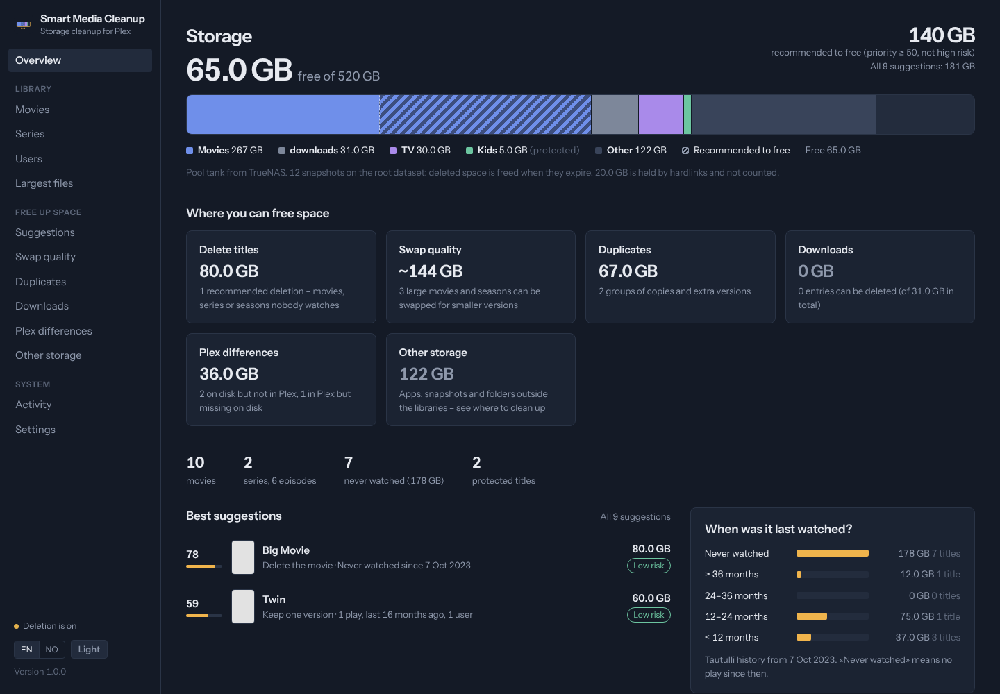
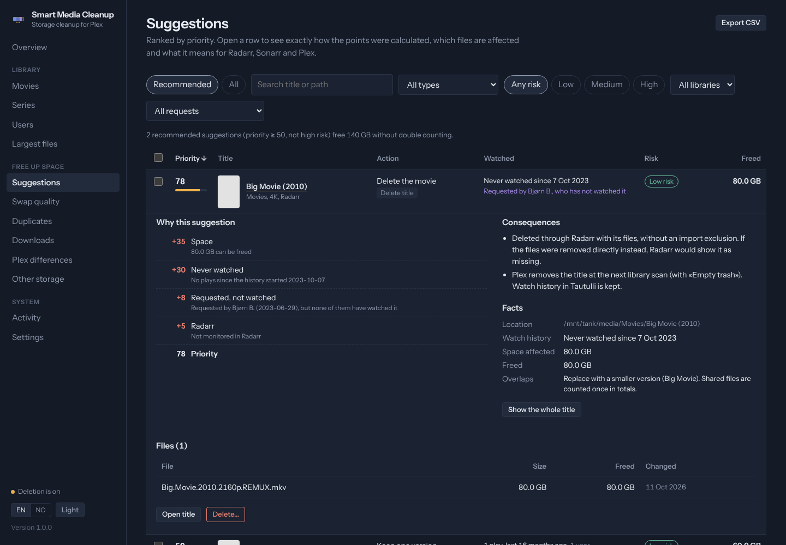
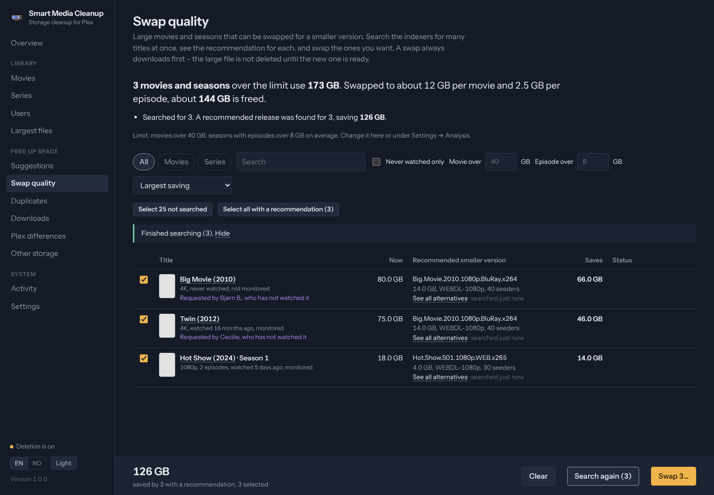
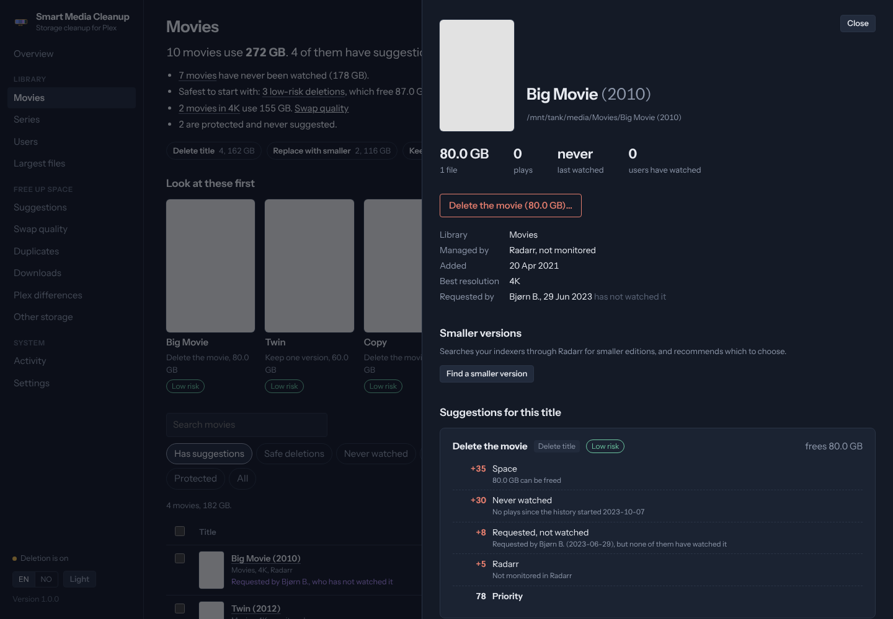
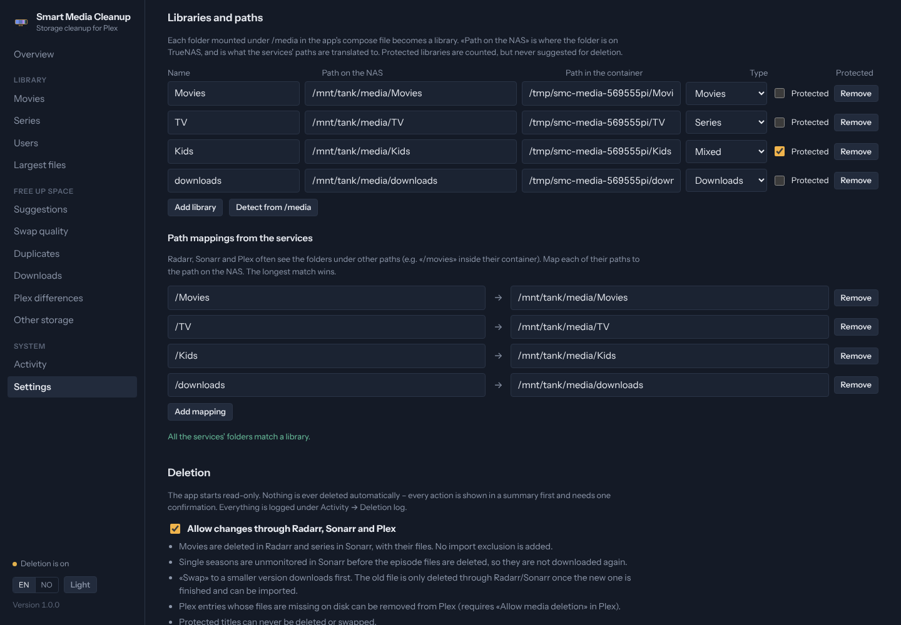
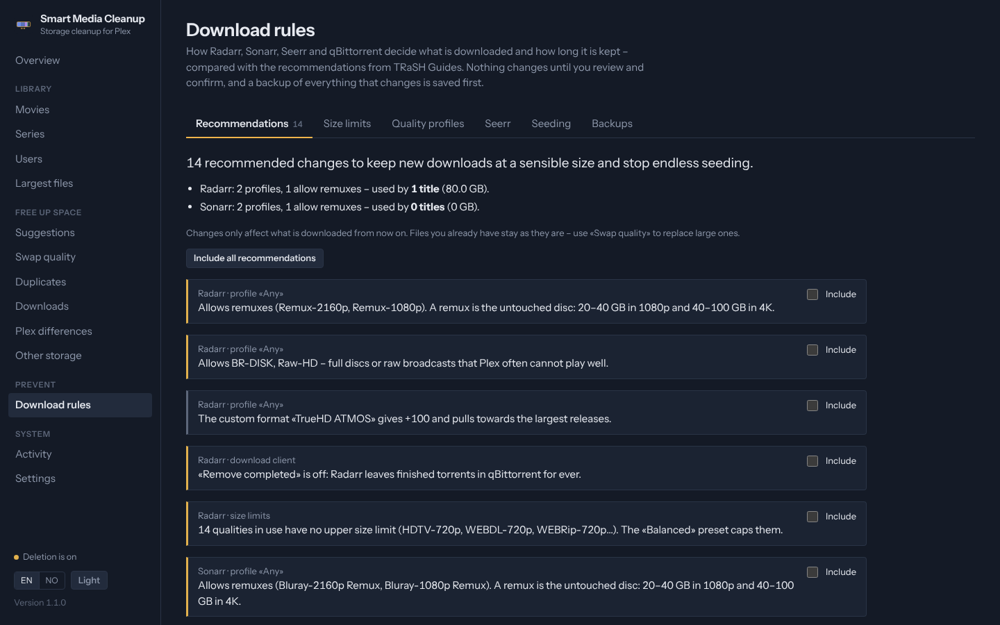
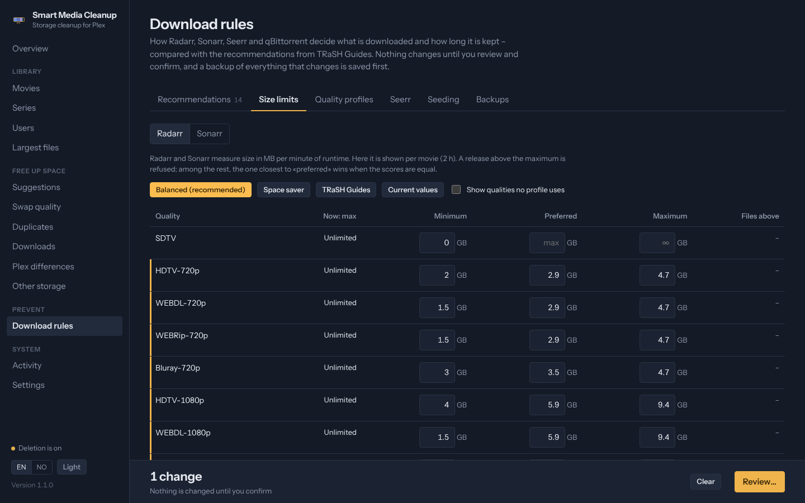
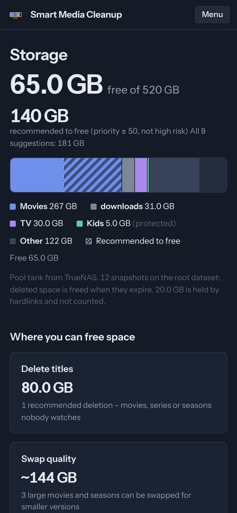

# Smart Media Cleanup (norsk)

Finn ut hva som fyller opp Plex-serveren – og frigjør plass trygt.

Smart Media Cleanup skanner mediemappene på en TrueNAS SCALE-server, kobler hver fil til Radarr, Sonarr, Plex, Tautulli og (valgfritt) Seerr, og gir deg rangerte, forklarte forslag: titler ingen ser på, 4K-remuxer som kunne vært mindre, duplikater, glemte nedlastinger og filer Plex aldri plukket opp. Besparelsen regnes per fil på disk, så hardlenker og overlappende forslag telles aldri dobbelt.

**Appen starter skrivebeskyttet.** Ingenting slettes automatisk. Sletting slås på separat for endringer gjennom Radarr/Sonarr/Plex og for filer på disk, og hver handling vises i en oppsummering først og krever én bekreftelse.

Webgrensesnittet finnes på **engelsk og norsk** (EN/NO i menyen). *[Read this in English](../README.md).*



<sub>Skjermbildene viser demodata fra de automatiske testene, ikke et ekte bibliotek.</sub>

---

## Innhold

1. [Hva appen gjør](#hva-appen-gjør)
2. [Sikkerhetsmodell](#sikkerhetsmodell)
3. [Installere på TrueNAS SCALE](#installere-på-truenas-scale)
4. [Første oppsett](#første-oppsett)
5. [Bruk](#bruk)
6. [Hvordan prioriteten beregnes](#hvordan-prioriteten-beregnes)
7. [Konfigurasjon](#konfigurasjon)
8. [Oppdatering](#oppdatering)
9. [Sikkerhetskopi og gjenoppretting](#sikkerhetskopi-og-gjenoppretting)
10. [Feilsøking](#feilsøking)
11. [Kjente begrensninger](#kjente-begrensninger)

Utviklerdokumentasjonen (kodestruktur, tester, språkkonvensjoner) finnes i den [engelske README-en](../README.md#development).

---

## Hva appen gjør

| Side | Hva du får |
|---|---|
| **Oversikt** | Kapasitet, hvor mye som er *anbefalt* å frigjøre (prioritet ≥ 50, ikke høy risiko), og ett kort per område der det kan frigjøres plass. En kom-i-gang-sjekkliste til alt er satt opp. |
| **Filmer / Serier** | Oppsummering (aldri sett, ikke sett på 12/24/36 måneder, trygge slettinger, 4K), «se på disse først» med plakater, og en filtrerbar liste med anbefaling per tittel. |
| **Brukere** | Per Seerr-bruker: hva de har bedt om, og om de har sett det selv. |
| **Største filer** | Enkeltfiler etter størrelse, med «Finn mindre» rett fra listen. |
| **Forslag** | Rangerte forslag. Hvert forslag viser poengene linje for linje, konsekvensene for Radarr/Sonarr/Plex og filene det gjelder. |
| **Bytt kvalitet** | Store filmer og sesonger. Søk i indekserne for mange samtidig, se anbefalt mindre utgivelse og bytt flere med én bekreftelse. |
| **Duplikater** | Identiske kopier, ekstra versjoner og hardlenker (som ikke tar plass) holdt fra hverandre. Velg hvilken fil som skal beholdes, og slett resten. |
| **Nedlastinger** | Hva som ligger i nedlastingsmappen, om det er importert, og hva som trygt kan fjernes. |
| **Plex-avvik** | Filer på disk som Plex ikke kjenner (med sannsynlig årsak), og Plex-oppføringer der filene er borte. |
| **Annen lagring** | Med TrueNAS-integrasjonen: hvilke datasett og snapshots som bruker plassen utenfor bibliotekene, og hvor de ryddes. Kun lesing. |
| **Nedlastingsregler** | Hvordan Radarr, Sonarr, Seerr og qBittorrent er satt opp, sammenlignet med TRaSH Guides: størrelsesgrenser per kvalitet, kvalitetsprofiler (remuxer, custom formats som drar opp størrelsen), Seerrs standardprofil og delingsgrenser. Endres med én bekreftelse; en sikkerhetskopi lagres først. |
| **Aktivitet** | Bakgrunnsjobber, pågående bytter og loggen over alt appen har slettet. |

| Forslag med forklaring | Bytt kvalitet |
|---|---|
|  |  |

| Tittelpanel | Innstillinger: biblioteker og stier |
|---|---|
|  |  |

| Nedlastingsregler | Størrelsesgrenser |
|---|---|
|  |  |



### Forslagstyper

| Type | Når | Frigjør |
|---|---|---|
| Slett tittel | En film eller serie over minstestørrelsen | Alle filene i mappen |
| Slett sesong | Serien blir sett, men én sesong er ikke sett på lenge | Den sesongens filer |
| Erstatt med mindre | En film over 40 GB eller en episode over 8 GB (justerbart) | Anslag: størrelse minus målstørrelse |
| Behold én versjon | Flere ulike filer for samme film/episode | De andre versjonene |
| Identisk kopi | Samme størrelse og delvis hash, ulik inode | Kopiene som ikke beholdes |
| Gammel nedlasting | En mappe i nedlastingsbiblioteket uten kopi i et bibliotek, eldre enn en måned | Mappen |

## Sikkerhetsmodell

| Regel | Hvordan |
|---|---|
| Skrivebeskyttet som standard | Mediemappene monteres `:ro`. Begge slettebryterne er av. |
| Ingenting automatisk | Appen foreslår bare. Hver handling viser en oppsummering og krever én bekreftelse. Serveren utfører nøyaktig det som ble vist (et token), og nekter hvis noe har endret seg siden. |
| Titler slettes gjennom Radarr/Sonarr | Filmer og serier slettes gjennom API-ene deres (med filer, uten importeksklusjon), så de holdes i synk og ikke lastes ned igjen. Enkeltsesonger slutter å overvåkes først. |
| Kontrollert rett før | Hver tittel hentes på nytt og mappen sammenlignes med analysen; hver fil kontrolleres for å være uendret siden skanningen, inne i et bibliotek og ikke en symlenke. Avvik stopper den handlingen. |
| Direkte filsletting er snevert | Kun overflødige duplikater (én fil blir alltid igjen), nedlastinger og mapper ingen tjeneste kjenner – og bare i mapper du monterer uten `:ro`. |
| Bytter laster ned først | Den store filen slettes først når den mindre er lastet ned og Radarr/Sonarr kan importere den. Alle andre importproblemer stopper byttet med den gamle filen urørt. |
| Beskyttelse | Biblioteker, Radarr/Sonarr-tagger (`keep`), Plex-etiketter og stier du markerer som beskyttet, foreslås aldri slettet eller byttet. |
| Minst mulig privilegier | Kjører som `568:568` (apps), `cap_drop: ALL`, `no-new-privileges`, skrivebeskyttet rotfilsystem. Bare mappene du monterer er synlige; appdata, `ix-apps` og lignende er utenfor rekkevidde. |
| Ingen ZFS-tilgang | Ingen `zfs`-kommandoer. Den valgfrie TrueNAS-integrasjonen bruker en API-nøkkel med rollen *Read-Only Admin*. Snapshots røres aldri. |
| Hemmeligheter | Lagres i `/data/settings.json` (modus 600) eller som miljøvariabler, maskert i API og grensesnitt. Nettleseren snakker bare med appen, så Plex-tokenet og API-nøklene forlater aldri serveren. |
| Nedlastingsregler | Størrelsesgrenser, profiler, Seerr- og qBittorrent-innstillinger endres bare etter en gjennomgang, og tjenestene leses på nytt først. Hver endret innstilling sikkerhetskopieres til `/data/backups/arr-setup-*.json` (modus 600) og kan gjenopprettes fra siden. Torrenter fjernes bare når de er ferdige og innholdet finnes i et bibliotek. |
| Loggført | Hver sletting, bytte og Plex-endring vises under Aktivitet → Slettelogg og lagres i databasen (`audit`). |

## Installere på TrueNAS SCALE

Testet på TrueNAS SCALE 25.10. Egne apper installeres med **Apps → Discover Apps → pilen ved «Custom App» → Install via YAML**.

### 1. Opprett datamappen

Opprett et datasett for appens data (f.eks. `tank/apps/mediacleanup`, forhåndsvalg *Apps*), og kjør så i TrueNAS-skallet:

```sh
mkdir -p /mnt/tank/apps/mediacleanup/data
chown -R 568:568 /mnt/tank/apps/mediacleanup/data
```

Bytt ut `tank` med navnet på din pool overalt.

### 2. Installer appen

1. Apps → **Discover Apps** → pilen/menyen ved **Custom App** → **Install via YAML**.
2. **Name:** `mediacleanup`.
3. **Custom Config:** lim inn [`deploy/truenas-app.yaml`](../deploy/truenas-app.yaml) og tilpass:
   - datamappen fra steg 1,
   - én linje per mediemappe: `- /mnt/<pool>/<sti>:/media/<Navn>:ro`,
   - `TZ` til din tidssone (f.eks. `Europe/Oslo`).
4. **Save.** TrueNAS henter `ghcr.io/pederko/smart-media-cleanup:latest` og starter appen på **http://&lt;truenas-ip&gt;:30480** (knappen **Web UI** åpner den).

Monter mappene Radarr, Sonarr og Plex bruker – typisk filmer, TV og nedlastingsmappen. Hver mappe under `/media` blir et bibliotek med mappens navn. Appen finner selv TrueNAS-stien bak hver montering.

<details><summary>Foretrekker du skjemaet «Install iX App»?</summary>

| Seksjon | Felt | Verdi |
|---|---|---|
| Application name | Name | `mediacleanup` |
| Image Configuration | Repository | `ghcr.io/pederko/smart-media-cleanup` |
| | Tag | `latest` |
| Container Configuration | Timezone | din tidssone |
| Security Context | Privileged | av |
| | Custom User | på, User ID `568`, Group ID `568` |
| Network Configuration | Ports | containerport `8000`, vertsport `30480`, TCP |
| Storage Configuration | Host Path | `/mnt/tank/apps/mediacleanup/data` → `/data` |
| | Host Path, Read Only | `/mnt/tank/media/Movies` → `/media/Movies` (én per mappe) |
| Resources | Limits | 1 CPU, 1024 MB (valgfritt) |

YAML-veien gir i tillegg skrivebeskyttet rotfilsystem, fjernede capabilities og Web UI-knappen.
</details>

### 3. Appikon (valgfritt)

TrueNAS har ikke noe ikonfelt for egne YAML-apper. Et lite skript setter det i appens metadata (det tar sikkerhetskopi først):

```sh
curl -fsSLo /tmp/set-icon.sh https://raw.githubusercontent.com/pederko/smart-media-cleanup/main/deploy/set-truenas-icon.sh
sh /tmp/set-icon.sh mediacleanup
```

Last Apps-siden på nytt. Redigering av appen kan nullstille ikonet – kjør skriptet igjen da.

## Første oppsett

Oversikten viser en sjekkliste til alt er på plass.

1. **Biblioteker** – oppdages ved første start fra mappene under `/media`. Kontroller navn, type (filmer, serier, blandet, nedlastinger) og beskyttelse under **Innstillinger → Biblioteker og stier**.
2. **Tilkoblinger** – under **Innstillinger → Tilkoblinger**: skriv inn adresse og nøkkel for hver tjeneste og trykk **Test tilkobling**:

   | Tjeneste | Adresse (fra containeren) | Nøkkel |
   |---|---|---|
   | Radarr | `http://<nas-ip>:<port>` | Settings → General → API Key |
   | Sonarr | `http://<nas-ip>:<port>` | Settings → General → API Key |
   | Plex | `http://<nas-ip>:32400` | X-Plex-Token: åpne et element → ⋯ → Get Info → View XML; tokenet står i adressen |
   | Tautulli | `http://<nas-ip>:<port>` | Settings → Web Interface → API key |
   | Seerr (valgfritt) | `http://<nas-ip>:<port>` | Settings → General → API Key |
   | TrueNAS (valgfritt) | `https://<nas-ip>` | API-nøkkel for en bruker med rollen *Read-Only Admin* |
   | qBittorrent (valgfritt) | `http://<nas-ip>:<port>` | Brukernavn og passord til Web UI |

   Bruk NAS-ens LAN-IP – `localhost` peker til appens egen container.
3. **Stimapping** – Radarr, Sonarr og Plex ser vanligvis mappene under andre stier (f.eks. `/movies` inne i sine containere). Etter første synkronisering leser appen rotmappene deres og foreslår mappinger ut fra mappenavn; trykk **Bruk** og lagre.
4. **Full oppdatering** – Aktivitet → **Kjør full oppdatering**. Deretter holder planleggeren alt oppdatert.

## Bruk

- **Start på oversikten.** Kortene viser hvor det kan frigjøres plass; hvert kort leder til sin side.
- **Forslag** åpner på *Anbefalt*. Åpne en rad for å se hvorfor. Velg rader og trykk **Slett valgte…**. **Eksporter CSV** gir samme liste i et regneark.
- **Bytt kvalitet:** velg titler, trykk **Søk** (én om gangen, maks 25 per runde, for å skåne indekserne), deretter **Bytt N…**. Velg hva som skjer etterpå: la Radarr/Sonarr være som før, slutt å overvåke, eller bytt kvalitetsprofil så de ikke «oppgraderer» tilbake.
- **Duplikater:** start med *Identiske kopier* – alltid trygt. Kontroller filen merket *Behold* i hver gruppe.
- **Nedlastinger:** filtrer på *Kan slettes*. Fjern torrenter som fortsatt seedes i nedlastingsklienten først.
- **Plex-avvik:** be Plex skanne en mappe på nytt, slett mapper som bare finnes på disk, eller fjern Plex-oppføringer der filene er borte (krever *Allow media deletion* i Plex → Settings → Library).

### Nedlastingsregler: stopp nye store filer og evig deling

Rydding hjelper én gang; reglene bestemmer hva som kommer inn etterpå. Under **Forebygg → Nedlastingsregler**:

- **Anbefalinger** viser hva som avviker fra anbefalt oppsett. Huk av det du vil, trykk **Se over…**, sjekk oppsummeringen og utfør.
- **Størrelsesgrenser**: velg *Balansert* (anbefalt), *Plassbesparende* eller *TRaSH Guides* og juster enkeltverdier. Størrelser vises per film (2 t) eller episode (45 min). Eksisterende filer røres ikke – tabellen viser hvor mange som er over de nye grensene, og *Bytt kvalitet* kan erstatte dem.
- **Kvalitetsprofiler**: stopp remuxer, BR-DISK og Raw-HD i en profil, eller opprett en anbefalt profil basert på en av dine (beholder custom formats). TRaSH sitt fulle sett med custom formats (utgivergrupper, HDR, lyd) synkroniseres best med [Recyclarr](https://recyclarr.dev) – denne siden rører bare det som styrer filstørrelsen.
- **Seerr**: velg profilen nye forespørsler får.
- **Deling**: for at ferdige torrenter skal forsvinne av seg selv, må qBittorrent stoppe en torrent når den har delt nok, og Radarr/Sonarr må ha *Remove completed* på. Begge kan settes her. Med qBittorrent tilkoblet kan ferdige torrenter som allerede ligger i et bibliotek fjernes med de nedlastede filene med en gang. Private trackere kan kreve en minste delingstid – reglene deres går foran.
- **Sikkerhetskopier**: hver endring lagrer de forrige innstillingene først; gjenopprett med ett klikk.

Endringer her krever *Tillat endringer via Radarr, Sonarr, Plex, Seerr og qBittorrent* under Innstillinger → Sletting.

### Slå på sletting

Under **Innstillinger → Sletting**:

- **Tillat endringer via Radarr, Sonarr, Plex, Seerr og qBittorrent** – slett filmer, serier og sesonger, bytt til mindre versjoner, fjern Plex-oppføringer uten filer og bruk nedlastingsregler.
- **Tillat sletting av filer på disk** – overflødige duplikater, nedlastinger og foreldreløse mapper. Fjern også `:ro` på de aktuelle mappene (Apps → mediacleanup → Edit). Seksjonen viser skrivetilgang per mappe.

Duplikater Radarr/Sonarr kjenner, slettes gjennom dem, etterfulgt av en ny skanning slik at de bruker filen du beholder (den må ligge i samme mappe). Beskyttelse gjelder hele titler; duplikater i beskyttede biblioteker kan fortsatt ryddes med mindre du slår på *Beskyttelse gjelder også duplikater*.

### Forespørsler (Seerr) og seerhistorikk

Med Seerr tilkoblet vises «Etterspurt av …» på titler og forslag, og **Brukere** viser per bruker hva de har bedt om og om de har sett det. Forespørsler kobles via TMDB/TVDB-id i Radarr/Sonarr og Plex-ratingKey for andre titler.

Seerhistorikken kommer fra Tautulli og går bare tilbake til da Tautulli ble installert. «Aldri sett» betyr derfor *ingen avspilling siden historikken startet* – datoen vises på oversikten. Avspillinger under 5 % telles ikke. Når en tittel ble erstattet i Plex og fikk ny ratingKey, matches avspillinger på navn og år.

## Hvordan prioriteten beregnes

Prioriteten (0–100) er en sum av synlige poeng – ingen skjult modell. Hvert forslag viser linjene sine.

| Faktor | Poeng |
|---|---|
| Plass som faktisk frigjøres | 0 til +35 (logaritmisk: 10 GB ≈ 12, 30 GB ≈ 24, 70 GB+ = 35) |
| Aldri sett siden historikken startet | +30 (+22 hvis lagt til etter at historikken startet) |
| Ikke sett på ≥ 36 / ≥ 24 / ≥ 12 måneder | +25 / +18 / +10 |
| Sett de siste 3 månedene | −20 |
| Maks 2 avspillinger og ≥ 20 GB | +8 |
| 10 avspillinger eller mer | −10 |
| Seere de siste 12 månedene | −6 per bruker (maks −30) |
| Overvåket i Radarr/Sonarr | −8 (ikke overvåket: +5) |
| Lagt til innenfor karantenen (6 måneder) | −40 |
| Ønsket i Seerr de siste 12 månedene | −15 |
| Ønsket for over 12 måneder siden, og ingen som ønsket den har sett den | +8 |
| Innholdet beholdes i en annen versjon | +25 (versjoner/kopier), +10 (erstatning) |

Alle terskler og vekter kan endres under Innstillinger → Analyse. Forslag under prioritet 20 skjules som standard; «anbefalt» betyr prioritet ≥ 50 og ikke høy risiko.

**Risiko:** *høy* hvis sett de siste 12 månedene, av to eller flere brukere nylig, nylig lagt til eller nylig ønsket. *Middels* hvis overvåket eller noen gang sett. Ellers *lav*. Identiske kopier har alltid lav risiko.

**Besparelse uten dobbelttelling:** hver fil (inode) telles én gang, med det største kravet blant de valgte forslagene. En hardlenket fil frigjør bare plass når alle stier til den er med; ellers vises den som «holdt av hardlenker». Størrelser er allokert plass på ZFS (`st_blocks`), ikke bare logisk størrelse.

## Konfigurasjon

Innstillingene lagres i `/data/settings.json` og redigeres i appen. Miljøvariabler overstyrer og låser feltene:

| Variabel | Betydning |
|---|---|
| `SMC_RADARR_URL`, `SMC_RADARR_API_KEY` | Radarr |
| `SMC_SONARR_URL`, `SMC_SONARR_API_KEY` | Sonarr |
| `SMC_PLEX_URL`, `SMC_PLEX_TOKEN` | Plex |
| `SMC_TAUTULLI_URL`, `SMC_TAUTULLI_API_KEY` | Tautulli |
| `SMC_SEERR_URL`, `SMC_SEERR_API_KEY` | Seerr/Overseerr |
| `SMC_TRUENAS_URL`, `SMC_TRUENAS_API_KEY` | TrueNAS (kun lesing) |
| `SMC_QBITTORRENT_URL`, `SMC_QBITTORRENT_USERNAME`, `SMC_QBITTORRENT_PASSWORD` | qBittorrent |
| `SMC_USERNAME`, `SMC_PASSWORD` | Slår på innlogging (basic auth) for webgrensesnittet |
| `SMC_LOG_LEVEL` | `INFO` (standard) eller `DEBUG` |
| `TZ` | Tidssone |

**Port:** endre `30480` under `ports:`. **Flere biblioteker:** legg til et volum `- /mnt/<pool>/<sti>:/media/<Navn>:ro` og trykk **Finn fra /media** under Innstillinger → Biblioteker og stier (eller legg til raden for hånd).

### Planlagte jobber

| Jobb | Standard |
|---|---|
| Synkronisering med tjenestene | hver 6. time |
| Inkrementell skanning | hver 24. time |
| Full skanning (stat av hver fil) | hver 7. dag, som del av en oppdatering |
| Oppfølging av bytter | hvert 5. minutt (oftere mens siden er åpen) |
| Se etter ny versjon på GitHub | hver 6. time |
| Sikkerhetskopi av database og innstillinger | daglig, 7 beholdes |

Bare én jobb kjører om gangen. Den inkrementelle skanningen stat-er bare filer i mapper der innholdet er endret (mappens mtime), og tar vanligvis sekunder. Delvis hash (12 MB per fil) regnes bare for filer med nøyaktig samme størrelse som en annen fil.

## Oppdatering

Compose-filen bruker `ghcr.io/pederko/smart-media-cleanup:latest`. Når en ny versjon publiseres:

1. Appen viser et banner med lenke til hva som er nytt (sjekkes hver 6. time; kan slås av under Innstillinger → Oppdateringer).
2. TrueNAS viser **Update available** på appen når den har sjekket bildet.
3. Oppdater med Apps → mediacleanup → ⋮ → **Update**. TrueNAS henter det nye bildet og starter appen på nytt. Databasen oppgraderes automatisk; innstillinger og sikkerhetskopier i `data/` beholdes.

Appen oppdaterer aldri seg selv.

**Hvor ofte sjekker TrueNAS?** TrueNAS sammenligner bildene til alle apper med registeret **én gang i døgnet** og når Apps-tjenesten starter, hvis «Check for image updates» er på under Apps → Configuration → Settings. For å sjekke med en gang, kjør dette i TrueNAS-skallet:

```sh
midclt -t 600 call app.image.op.check_update
```

Uten `-t 600` kan kallet melde «Call timeout» fordi det sjekker alle apper; sjekken fortsetter likevel. Last deretter Apps-siden på nytt.

**Lås en versjon:** erstatt `:latest` med en versjon (f.eks. `:1.0.0`) under Edit. Gå tilbake til en tidligere versjon på samme måte.

## Sikkerhetskopi og gjenoppretting

Alt som er verdt å ta vare på ligger i datamappen (f.eks. `/mnt/tank/apps/mediacleanup/data`):

- `settings.json` – tilkoblinger, terskler, beskyttelse.
- `smc.sqlite3` – hurtigbuffer og analyse. Kan alltid bygges opp igjen med en full oppdatering.
- `backups/` – daglige kopier av begge (7 beholdes).
- `posters/` – mellomlagrede plakater.

En periodisk snapshot-oppgave på appens datasett er et godt tillegg. Appen selv rører aldri snapshots.

**Gjenoppretting:** stopp appen, kopier ønsket `backups/settings-*.json` til `data/settings.json` (og eventuelt `backups/smc-*.sqlite3` til `data/smc.sqlite3`), start appen.

## Feilsøking

| Symptom | Årsak og løsning |
|---|---|
| Appen starter ikke, «manifest unknown» / «denied» | Feil tag eller bildenavn (må være små bokstaver). |
| «Mappene for … ble ikke funnet i containeren» | Volumet mangler i compose-filen, eller containerstien under Innstillinger → Biblioteker stemmer ikke. |
| `Permission denied` i loggen | Datamappen eies ikke av 568: `chown -R 568:568 <datamappe>`. Mediemappene må være lesbare for 568. |
| «Ingen forbindelse til …» | Bruk LAN-IP, ikke `localhost`. Sjekk porten. |
| «Autentisering avvist (401)» | Feil API-nøkkel/token. Plex-tokenet endres hvis du logger ut av alle enheter. |
| Filmer i Radarr kobles ikke til filene sine | Stimappingen mangler. Se forslagene under Innstillinger → Biblioteker og stier. |
| Mange titler «aldri sett» som du vet er sett | Tautulli-historikken er kortere enn du tror (se datoen på oversikten). |
| En film frigjør 0 GB | Filen er hardlenket fra nedlastingsmappen. Velg kopien der også, eller fjern torrenten. |
| Sletteknappene sier at bryteren er av | Slå den på under Innstillinger → Sletting. Filer på disk krever også at `:ro` fjernes. |
| «Slett 0 filer» / «montert skrivebeskyttet» | Mappen er montert `:ro`. Fjern `:ro` under Edit på appen. |
| Et bytte sier «Trenger hjelp» | Radarr/Sonarr hadde innvendinger mot filen. Den gamle filen er urørt. Les meldingen, og importer eller fjern nedlastingen under Activity → Queue i Radarr/Sonarr. |
| Sonarr-synk sier «Ikke funnet: /api/v3/episodefile (404)» | Rettet i 1.1: appen leser filene på en annen måte og hopper over serier Sonarr ikke lenger kjenner. Feiler alle serier, sjekk Sonarr-adressen (inkludert eventuell URL-base). |
| qBittorrent «avviste brukernavn eller passord» | Sjekk Web UI-brukeren. Etter flere mislykkede forsøk utestenger qBittorrent IP-en en stund. |
| Plex nekter å fjerne oppføringer | Slå på «Allow media deletion» i Plex → Settings → Library. |
| Update-knappen i TrueNAS er grå | TrueNAS har ikke sjekket ennå (én gang i døgnet). Kjør `midclt -t 600 call app.image.op.check_update`. |

Logger: Apps → mediacleanup → Logs. Feilede jobber viser hele feilen under Aktivitet (klikk på raden). API-dokumentasjon: `http://<nas-ip>:30480/api/docs`.

## Kjente begrensninger

- Søket etter mindre versjoner kjøres bare når du ber om det, per tittel eller sesong, for å skåne indekserne. For serier vurderes bare hele sesongpakker.
- Et bytte er avhengig av at Radarr/Sonarr kan importere filen. Krever importen manuelle valg, stopper byttet uten å slette noe.
- Identiske kopier avgjøres med størrelse + delvis hash (start, midt, slutt). Det er trygt i praksis for videofiler, men det er ikke en full hash.
- Mapper med uendret mtime stat-es ikke av den inkrementelle skanningen. Filer endret på stedet uten at mappen endres, fanges av den ukentlige fulle skanningen.
- Plex-etiketter beskytter filmer og serier, ikke enkeltepisoder.
- Titler som verken er i Radarr eller Sonarr kan ikke slettes som helhet fra appen, bortsett fra som mapper på disk under Plex-avvik.
- Bare qBittorrent støttes for opprydding i deling. Torrenter fjernes bare når de er ferdige og innholdet finnes i et skannet bibliotek.
- Nedlastingsregler synkroniserer ikke TRaSH sitt fulle sett med custom formats; bruk Recyclarr eller Notifiarr til det.
